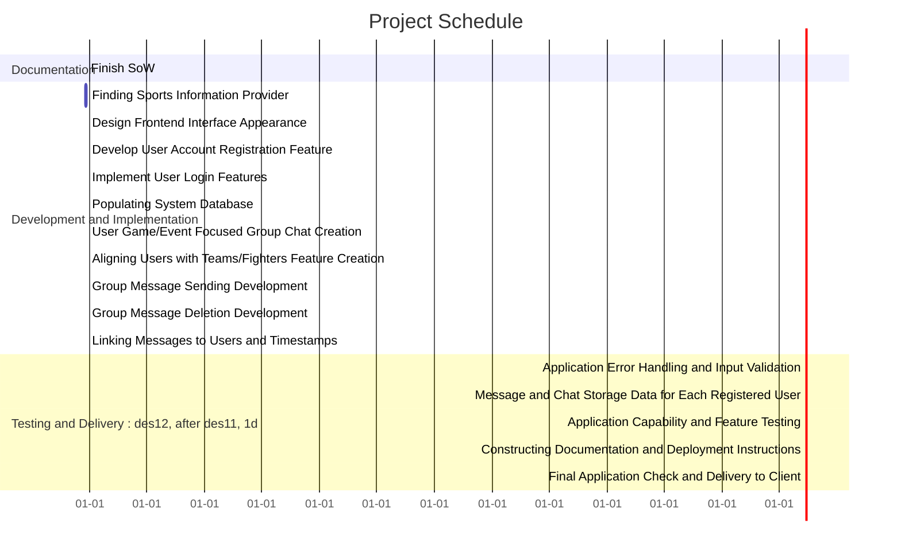

# Statement of Work (SoW)

- **Project Name**: Ball Knowledge Bulletin (*BKB*)
- **Developers**:
  - Ash Ahmed Abdullah F AlHarbi (GitHub: AshAlharbi)
  - Sebastien Finch (GitHub: SebasFinch)
  - Sean Hamilton (GitHub: hamiltons15)
  - Jeremy Sowder (GitHub: sowderj1)
- **Project Period**: 11/9/2026 - 12/7/2026 ???
- **Version**: 0.1
- **Last Updated**: 11/13/2026

---

## SoW Overview:

- (**1**) - Project Purpose and Objectives

- (**2**) - Stakeholders

- (**3**) - Scope

- (**4**) - Deliverables

- (**5**) - Assumptions, Constraints, and Dependencies

- (**6**) - Milestones and Schedule

- (**7**) - Acceptance

---

### (1) - Project Purpose and Objectives

#### Purpose

...

#### Objectives

...

---

### (2) - Stakeholders

1. Stakeholder: **Client**
> - Relationships: Those who are requesting the development of *BKB*, and defining and communicating the expected sports data and desired communication features.
3. Stakeholder: **Developers**
> - Relationship: Responsible for developing, designing, implementing features, testing, documenting, and delivering the *BKB* application.
4. Stakeholder: **End User**
> - Relationship: Any and all registered users who use *BKB* to view sporting game/event data and to communicate with other registered users.
5. Stakeholder: **System Administrator**
> - Relationship: Given the role of being in charge of maintaining the deployed *BKB* application and the infrastructure that comes with it.

---

### (3) - Scope

...

---

###### (4) - Deliverables

When considering the deliverables of {*BKB*}, we need to consider these deliverables as a hierarchy of deliverables with certain sub-deliverables, such that the outermost deliverable is the {*BKB*} application itself. By definition, sub-deliverables are deliverables that another 'parent' deliverable depends upon to fulfil its defined deliverable functionality, even those without a place within the working application. These dependencies are listed in the Depends On column below.

Deliverables for {*BKB*} will generally consist of documentation essential to comprehending the purpose, what is promised, what is delivered, what is required, the subsequent analysis thereof, and an honest reflection on the ethics concerning the construction of {*BKB*}. Beyond this critical documentation, deliverables and sub-deliverables alike shall serve as key components of the {TBD APP NAME} deliverable itself.

For the purposes of this document, a 'Team' refers to an NFL, NBA, or MLB team, or an individual UFC fighter, and a 'Matchup' refers to a game or fight between two Teams. Deliverables with a lowercase ID (e.g. d34) are minor deliverables. Every application deliverable (D10 and above) is additionally documented as part of Verification (D03).

From this point of understanding and subsequent departure, each deliverable is accepted according to the following criteria:

| ID  | Deliverable                                                  | Depends On | Acceptance Criteria                                                                                                                                                                                           |
| --- | ------------------------------------------------------------ | ---------- | ------------------------------------------------------------------------------------------------------------------------------------------------------------------------------------------------------------- |
| D00 | Statement of Work                                            | —          | Contains each section listed in the SoW Overview; committed to the repository and submitted on GitHub                                                                                                         |
| D01 | Requirements Engineering                                     | D00        | Contains all required sections; committed to the repository and submitted on GitHub                                                                                                                           |
| D02 | Diagrams and Analysis                                        | D01        | Contains all required sections; committed to the repository and submitted on GitHub                                                                                                                           |
| D03 | Verification Documentation                                   | D02        | Contains all required sections; committed to the repository and submitted on GitHub                                                                                                                           |
| D10 | Sports Data Retrieval, Storage, & Availability               | —          | {TBD APP NAME} retrieves NFL, NBA, MLB, or UFC data from an external sports data source; said data is stored and available on the {BKB} platform                                                     |
| D11 | Sports Data Aggregation                                      | D10        | Sports Data is refined & concentrated into the Team, Schedule, and Matchup data required by D20–D22                                                                                                           |
| D20 | Team Data                                                    | D11        | Each Team in the supported leagues is stored and retrievable on the {BKB} platform                                                                                                                   |
| D21 | Team Game Schedule Data                                      | D20        | The Game Schedule for each Team is stored and retrievable on the {BKB} platform                                                                                                                      |
| D22 | Team Matchup Data                                            | D21        | Team Matchup Data (participants, time, and score or result) is stored for each game in the Team Game Schedule Data                                                                                            |
| D30 | Team Matchup Pages                                           | D22        | For each team matchup, there exists a unique page                                                                                                                                                             |
| D31 | Team Matchup Threads                                         | D30        | For each team matchup page, there exists a distinct thread                                                                                                                                                    |
| D32 | Team Matchup Thread Limited Persistence                      | D31        | Team matchup threads open a defined period before the matchup, remain open during the matchup, and close a defined period after the matchup ends; these periods are defined in Requirements Engineering (D01) |
| D33 | Team Matchup Thread Messages                                 | D31        | Each Thread has the capacity to contain messages                                                                                                                                                              |
| d34 | Team Matchup Thread Message Priority                         | D33        | Team Matchup Thread Messages display according to the priority schema defined in Requirements Engineering (D01)                                                                                               |
| D40 | User Identification                                          | —          | A user can register, login, and be identified                                                                                                                                                                 |
| D41 | User Favorite Team Selection & Representation                | D20, D40   | A registered user can select their favorite team, and it is represented on their User and used to personalize their dashboard (D44)                                                                           |
| D42 | User Accessibility of Team Matchup Data on Team Matchup Page | D30        | Users can see Team Matchup Data on each Team Matchup Page                                                                                                                                                     |
| D43 | User Matchup Thread Participation                            | D33, D40   | Users can view, send, and receive messages in each open Team Matchup Thread, with new messages appearing without a page refresh                                                                               |
| D44 | Personalized User Dashboard                                  | D22, D41   | A registered user's dashboard displays scores, results, and upcoming Matchups, prioritizing their favorite Team, and can be filtered by sport                                                                 |

---

### (5) - Assumptions, Constraints, and Dependencies

...

---

### (6) - Milestones and Schedule

#### Milestones

- Milestone 1 - SoW Completed
- Milestone 2 - Graphical User Interface (GUI) Implemented
- Milestone 3 - Fully Collected Game/Event Data and Implemented Score Tracking Capabilities
- Milestone 4 - User Group Messaging Capabilities Implemented
- Milestone 5 - Final Documentation Completed

#### Schedule

Order of Events:
- Finished Constructing SoW (November 9th - November 16th)
- Finding Sports Information Provider (November 17th - November 18th)
- Design Frontend Interface Appearance (November 18th - November 19th)
- Develop User Account Registration Feature (November 19th - November 20th)
- Implement User Login Features (November 20th - November 21st)
- Populating System Database (November 21st - November 22nd)
- User Game/Event Focused Group Chat Creation (November 22nd - November 23rd)
- Aligning Users with Teams/Fighters Feature Creation (November 23rd - November 24th)
- Group Message Sending Development (November 24th - November 25th)
- Group Message Deletion Development (November 25th - November 26th)
- Linking Messages to Users and Timestamps (November 26th - November 27th)
- Application Error Handling and Input Validation (November 27th - November 28th)
- Message and Chat Storage Data for Each Registered User (November 28th - November 29th)
- Application Capability and Feature Testing (November 29th - November 30th)
- Constructing Documentation and Deployment Instructions (November 30th - December 1st)
- Final Application Check and Delivery to Client (December 1st - December 2nd)

Gantt Chart:

---

### (7) - Acceptance

Statement of Work (SoW)
> - Acceptance: ...

Functioning *BKB* Application
> - Acceptance: ...

Documentation of Application Testing
> - Acceptance: ...

Finished GitHub Repository
> - Acceptance: ...

---
