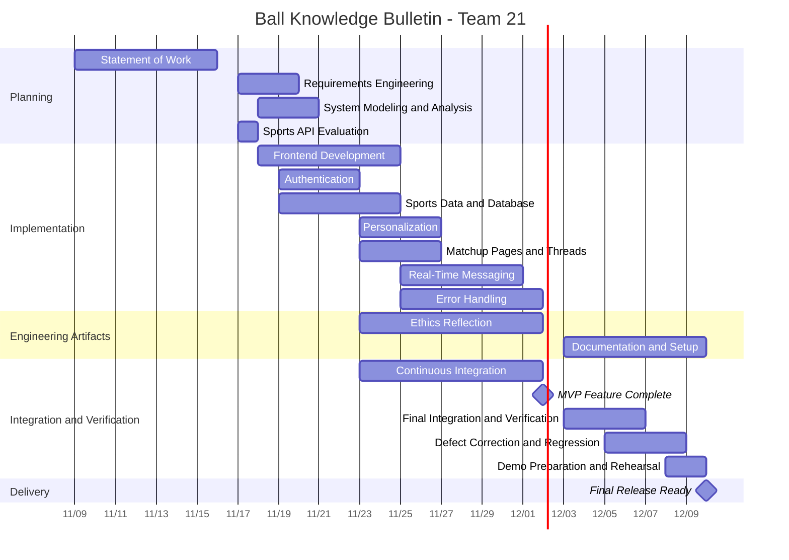

# Statement of Work (SoW)

- **Project Name**: *Ball Knowledge Bulletin*
- **Team 21 Pathway**: Option 2 Original MERN Stack Project
- **Developers**:
  - Ash Ahmed Abdullah F AlHarbi (GitHub: AshAlharbi)
  - Sebastien Finch (GitHub: SebasFinch)
  - Sean Hamilton (GitHub: hamiltons15)
  - Jeremy Sowder (GitHub: sowderj1)
- **Project Period**: 11/9/2026 - 12/11/2026 
- **Version**: 0.1
- **Last Updated**: 11/15/2026

---

## SoW Overview:

- (**1**) - Project Purpose and Objectives

- (**2**) - Stakeholders

- (**3**) - Scope

- (**4**) - Deliverables

- (**5**) - Assumptions, Constraints, and Dependencies

- (**6**) - Milestones and Schedule

- (**7**) - Acceptance

---

### (1) - Project Purpose and Objectives

#### Purpose

The purpose of *Ball Knowledge Bulletin* is to provide sports fans with a centralized platform where they can view sporting event information, personalize their experience based on their favorite teams, and communicate with other users through event-specific group messaging. Rather than requiring users to navigate between separate platforms to check scores, view upcoming events, and discuss games, *Ball Knowledge Bulletin* aims to combine these capabilities into a single application.

The application will be developed using the MongoDB, Express, React, and Node.js (MERN) technology stack. *Ball Knowledge Bulletin* will retrieve sporting event information from an external data provider, maintain registered user accounts and preferences, and support persistent group messaging associated with individual sporting events.

The initial minimum viable product (MVP) will focus exclusively on the National Football League (NFL). This will allow the development team to prioritize implementing and verifying the application's core functionality before considering additional sporting leagues, including the NBA, MLB, and UFC.

**Problem Statement:** Sports fans often rely on separate platforms to access game information and communicate with other fans. This makes it less convenient to follow favorite teams, view NFL matchups, and participate in discussions specific to individual games.

**Intended Outcome:** *Ball Knowledge Bulletin* aims to provide a centralized sports platform where registered users can select their favorite NFL team, access schedules and game information through a personalized dashboard, and participate in real time, matchup specific group discussions. The system will maintain persistent messages and keep discussions separated by game.

#### Objectives

The primary objectives of *Ball Knowledge Bulletin* are as follows:

1. **User Registration and Authentication:** Allow users to register accounts, securely log in, and access application features associated with their authenticated identity.

2. **Personalized Sports Dashboard:** Provide registered users with a dashboard that displays NFL game schedules, available scores, and results, while prioritizing information associated with their selected favorite NFL team.

3. **Sports Data Retrieval and Availability:** Retrieve NFL team and game information from a documented external sports data provider, store the necessary information, and make it accessible through the *Ball Knowledge Bulletin* application. The system will also handle missing scores, unavailable events, and failures when retrieving external data.

4. **Event Specific Group Messaging:** Provide a distinct group messaging thread for each supported NFL game, allowing registered users to participate in discussions associated with individual matchups.

5. **Real Time Communication and Message Persistence:** Allow authenticated users to send and receive messages without refreshing the page, while storing messages so that discussion history remains available when users return to an event.

6. **Application Reliability and Verification:** Develop and verify a functional MERN application that enforces user authentication, separates messages by event, handles invalid requests, and provides reproducible evidence that the required features operate as intended.

---

### (2) - Stakeholders

1. Stakeholder: **Client**
> - Relationships: Those who are requesting the development of *Ball Knowledge Bulletin*, and defining and communicating the expected sports data and desired communication features.
2. Stakeholder: **Developers**
> - Relationship: Responsible for developing, designing, implementing features, testing, documenting, and delivering the *Ball Knowledge Bulletin* application.
3. Stakeholder: **End User**
> - Relationship: Any and all registered users who use *Ball Knowledge Bulletin* to view sporting game/event data and to communicate with other registered users.
4. Stakeholder: **System Administrator**
> - Relationship: Given the role of being in charge of maintaining the deployed *Ball Knowledge Bulletin* application and the infrastructure that comes with it.

---

### (3) - Scope

The scope of *Ball Knowledge Bulletin* consists of developing a functional sports networking application using the MongoDB, Express, React, and Node.js (MERN) technology stack. The application will provide registered users with personalized sporting information and the ability to communicate with other users through public group messaging associated with individual sporting events.

The initial minimum viable product (MVP) will focus exclusively on the National Football League (NFL). While the original project concept included the NFL, NBA, MLB, and UFC, the team has decided to prioritize one league to ensure that the core application functionality can be implemented, integrated, and verified within the available project period.

#### In-Scope Functionality

The following capabilities will be included within the initial *Ball Knowledge Bulletin* application:

1. **User Registration and Authentication:** Users will be able to register an account, log in, and access features associated with their authenticated identity. The application will maintain user information and enforce authentication requirements for participating in group messaging.

2. **Favorite Team Selection:** Registered users will be able to select an NFL team as their favorite. This selection will be stored within their account and used to personalize the sporting information displayed on their dashboard.

3. **Personalized Sports Dashboard:** The application will provide users with an interface displaying NFL teams, upcoming games, available scores, and completed game results. Information associated with a user's favorite team will be prioritized.

4. **Sports Data Retrieval and Storage:** *Ball Knowledge Bulletin* will retrieve NFL team, schedule, and matchup information from an external sports data provider. The necessary information will be processed and stored within the application's database. The application will distinguish between upcoming, ongoing, and completed games when that information is available.

5. **Individual Matchup Pages:** Each supported NFL game will have a distinct matchup page displaying its participating teams, scheduled time, and available score or result. Users will be able to navigate from the dashboard to individual matchup pages.

6. **Event Specific Group Messaging:** Each supported NFL matchup will have an associated public discussion thread. Authenticated users will be able to send and receive messages within an open thread, with new messages appearing without requiring a page refresh. Messages will be associated with their respective users, timestamps, and matchups.

7. **Message Persistence and Thread Management:** Messages will be stored within the application's database and remain associated with their corresponding matchup. Discussion threads will follow a defined lifecycle that determines when they become available for participation, when they close, and how previous messages remain accessible.

8. **Error Handling and Input Validation:** The application will validate user input and handle unsuccessful operations, including invalid authentication, unavailable sporting information, missing game results, and external API failures. When current sporting information cannot be retrieved, the application will display an appropriate message rather than presenting unavailable or outdated information as current.

#### Minimum Complete Project

The minimum complete *Ball Knowledge Bulletin* application will demonstrate an integrated workflow in which a user can register an account, log in, select a favorite NFL team, view personalized game information, navigate to a specific NFL matchup, and participate in its associated group discussion.

The application must also demonstrate that messages are stored and retrieved correctly, discussions remain separated by respective NFL matchups, unauthorized users cannot submit messages, and unavailable sporting information is handled appropriately.

All required functionality must operate together through the MERN application rather than as separate demonstrations of individual components.

#### Out of Scope Functionality

The following capabilities are excluded from the initial MVP:

- Support for sporting leagues beyond the NFL, including the NBA, MLB, and UFC.
- Private messaging or direct messaging between individual users.
- User created discussion rooms unrelated to an NFL matchup.
- Sports betting, gambling functionality, or predictions involving financial transactions.
- Video streaming or broadcasting of live sporting events.
- A dedicated mobile application separate from the web based application.

These exclusions establish boundaries for the initial release and allow the team to prioritize the required engineering functionality.

#### Optional Enhancements

If the required MVP functionality has been implemented, integrated, and verified, the team may consider implementing additional capabilities, including:

- Support for additional sporting leagues, including the NBA, MLB, and UFC.
- Filtering the sports dashboard by league when multiple leagues are supported.
- Advanced message organization or prioritization within matchup discussion threads.
- User message deletion functionality.
- Additional dashboard customization and interface improvements.

Optional enhancements will only be attempted after all required MVP functionality has been implemented, integrated, and verified. The development team will evaluate the remaining project schedule before approving additional features to ensure that sufficient time remains for final testing, documentation, and demonstration preparation. Optional enhancements will not replace or delay the completion of required deliverables.

---

### (4) - Deliverables

When considering the deliverables of *Ball Knowledge Bulletin*, we need to consider these deliverables as a hierarchy of deliverables with certain sub-deliverables, such that the outermost deliverable is the *Ball Knowledge Bulletin* application itself. By definition, sub-deliverables are deliverables that another 'parent' deliverable depends upon to fulfil its defined deliverable functionality, even those without a place within the working application. These dependencies are listed in the Depends On column below.

Deliverables for *Ball Knowledge Bulletin* will generally consist of documentation essential to comprehending the purpose, what is promised, what is delivered, what is required, the subsequent analysis thereof, and an honest reflection on the ethics concerning the construction of *Ball Knowledge Bulletin*. Beyond this critical documentation, deliverables and sub-deliverables alike shall serve as key components of the *Ball Knowledge Bulletin* deliverable itself.

For the purposes of this document, a 'Team' refers to an NFL, NBA, or MLB team, or an individual UFC fighter, and a 'Matchup' refers to a game or fight between two Teams. However, the (MVP) will only focus on NFL teams and matchups. Deliverables with a lowercase ID (e.g. d34) are minor deliverables. Every application deliverable (D10 and above) is additionally documented as part of Verification (D03).

From this point of understanding and subsequent departure, each deliverable is accepted according to the following criteria:

| ID  | Deliverable                                                  | Depends On | Acceptance Criteria                                                                                                                                                                                           |
| --- | ------------------------------------------------------------ | ---------- | ------------------------------------------------------------------------------------------------------------------------------------------------------------------------------------------------------------- |
| D00 | Statement of Work                                            | —          | Contains each section listed in the SoW Overview; committed to the repository and submitted on GitHub                                                                                                         |
| D01 | Requirements Engineering                                     | D00        | Contains functional and quality requirements with unique IDs, acceptance criteria, and verification traceability; saved in `requirements.md`                                                         |
| D02 | Diagrams and Analysis                                        | D01        | Contains a DFD or Sequence Diagram with supporting analysis; editable source and rendered diagrams                                                                             |
| D03 | Verification Documentation                                   | D01, D02   | Documents test procedures, expected and actual results, and evidence verifying required MVP functionality; saved in `verification.md`                                                                   |
| D04 | Ethics Reflection                                            | D01, D02   | Evaluates cultural, economic, environmental, global, health, safety, welfare, and social impacts with appropriate mitigations; saved in `ethics-reflection.md`                                   |
| D05 | Integrated Application and Setup                             | D10-D44    | Working MERN application with documented setup instructions; required MVP workflows function correctly from a fresh checkout                                                                                               |
| D06 | Final Showcase                                               | D03-D05    | Team presents a lightning talk and live demonstration of required MVP features with supporting verification evidence                                                                                           |
| D10 | Sports Data Retrieval, Storage, & Availability               | —          | *Ball Knowledge Bulletin* retrieves NFL data from an external sports data source; said data is stored and available on the *Ball Knowledge Bulletin* platform                                                     |
| D11 | Sports Data Aggregation                                      | D10        | Sports Data is refined & concentrated into the Team, Schedule, and Matchup data required by D20–D22                                                                                                           |
| D20 | Team Data                                                    | D11        | Each Team in the supported leagues is stored and retrievable on the *Ball Knowledge Bulletin* platform                                                                                                                   |
| D21 | Team Game Schedule Data                                      | D20        | The Game Schedule for each Team is stored and retrievable on the *Ball Knowledge Bulletin* platform                                                                                                                      |
| D22 | Team Matchup Data                                            | D21        | Team Matchup Data (participants, time, and score or result) is stored for each game in the Team Game Schedule Data                                                                                            |
| D30 | Team Matchup Pages                                           | D22        | For each team matchup, there exists a unique page                                                                                                                                                             |
| D31 | Team Matchup Threads                                         | D30        | For each team matchup page, there exists a distinct thread                                                                                                                                                    |
| D32 | Team Matchup Thread Limited Persistence                      | D31        | Team matchup threads open a defined period before the matchup, remain open during the matchup, and close a defined period after the matchup ends; these periods are defined in Requirements Engineering (D01) |
| D33 | Team Matchup Thread Messages                                 | D31        | Each Thread has the capacity to contain messages                                                                                                                                                              |
| d34 | Team Matchup Thread Message Priority                         | D33        | Team Matchup Thread Messages display according to the priority schema defined in Requirements Engineering (D01)                                                                                               |
| D40 | User Identification                                          | —          | A user can register, login, and be identified                                                                                                                                                                 |
| D41 | User Favorite Team Selection & Representation                | D20, D40   | A registered user can select their favorite team, and it is represented on their User and used to personalize their dashboard (D44)                                                                           |
| D42 | User Accessibility of Team Matchup Data on Team Matchup Page | D30        | Users can see Team Matchup Data on each Team Matchup Page                                                                                                                                                     |
| D43 | User Matchup Thread Participation                            | D33, D40   | Users can view, send, and receive messages in each open Team Matchup Thread, with new messages appearing without a page refresh                                                                               |
| D44 | Personalized User Dashboard                                  | D22, D41   | A registered user's dashboard displays scores, results, and upcoming Matchups, prioritizing their favorite Team                                                                |

---

### (5) - Assumptions, Constraints, and Dependencies

The development and successful delivery of *Ball Knowledge Bulletin* depend on several assumptions, constraints, and dependencies. These conditions establish the circumstances under which the application will be developed, identify potential limitations, and help the development team prepare for problems that may arise throughout the project.

#### Assumptions

The following assumptions concern conditions that have not yet been fully confirmed:

1. **Sports Data Availability:** The team assumes that an external sports data provider can supply sufficient NFL team, schedule, matchup, and scoring information to support the minimum viable product (MVP).

2. **External API Accessibility:** The team assumes that a suitable sports data provider will offer an accessible API with usage limits and restrictions that allow the application to retrieve the information required for its core functionality.

3. **Development Environment:** The team assumes that all four developers will have continued access to the necessary development tools, software, and computing resources throughout the project period.

4. **User Connectivity:** The application assumes that users will have an internet connection when accessing sporting information and participating in real time group messaging.

5. **Testing Resources:** The team assumes that sufficient test accounts, NFL event data, and development environments will be available to verify the application's required workflows.

#### Constraints

The following constraints establish known limitations and requirements that the team must follow:

1. **Technology Stack:** As required by the original project pathway, *Ball Knowledge Bulletin* must be developed using the MongoDB, Express, React, and Node.js (MERN) technology stack. Supporting libraries and technologies may be used but will not replace these required components.

2. **Development Period:** The project must be completed within the remaining Fall 2026 Capstone I semester. The Statement of Work must be submitted by November 16, 2026, and the completed application and supporting engineering artifacts must be ready for the team's scheduled final exam period.

3. **Team Size:** Development will be performed by the four confirmed team members. Work must be distributed among the developers while allowing sufficient time for integration, testing, and verification.

4. **MVP Scope:** The initial release will focus exclusively on NFL information and event specific group messaging. Additional sporting leagues will not be required for MVP completion.

5. **External Data Limitations:** The application will be subject to the selected sports data provider's available information, request limits, update frequency, and access restrictions. The team cannot guarantee that external sporting information will always be available or updated immediately.

6. **Required Engineering Artifacts:** In addition to the functioning application, the team must deliver requirements engineering documentation, diagrams and analysis, an ethics reflection, implementation and verification evidence, and a final project demonstration.

#### Dependencies

The following dependencies identify components, services, and decisions required for the successful development of *Ball Knowledge Bulletin*:

1. **Sports Data Provider:** The application depends on selecting and integrating an external NFL data provider. The team must confirm the provider's available data fields, access requirements, request limits, and refresh capabilities before finalizing the sports data retrieval implementation.

2. **Database Availability:** MongoDB will be required to store user accounts, favorite team selections, NFL team and event information, discussion rooms, and message history. Database availability is necessary for functionality involving persistent information.

3. **Backend Services:** The Express and Node.js backend will be responsible for processing application requests, validating user input, enforcing authentication requirements, communicating with MongoDB, and retrieving external sporting information.

4. **Frontend Integration:** The React frontend will depend on the backend services to retrieve sporting information, authenticate users, display personalized dashboards, and support event specific messaging.

5. **User Authentication:** Group messaging and favorite team personalization depend on identifying authenticated users. Registration and login functionality must therefore be implemented before these features can be fully verified.

6. **NFL Event Identification:** Individual matchup pages and discussion rooms depend on consistently identifying NFL games. Each supported event must have a unique identifier so that its sporting information and associated messages remain separate from other events.

7. **Real Time Communication:** Live group messaging depends on communication between connected clients and the backend. Messages must be associated with the correct authenticated user and matchup before being distributed to other participants.

#### Risks and Mitigation Strategies

The team recognizes that certain technical and scheduling risks could affect the successful completion of the project.

| Risk | Potential Impact | Mitigation or Fallback |
| --- | --- | --- |
| External sports API becomes unavailable or access is restricted | NFL game information may not be retrieved or updated | Display the most recently stored information with an indication that it may be outdated, or show an appropriate unavailable data message |
| Sports data is incomplete or missing | Matchup pages may not contain current scores or results | Display available matchup information and clearly indicate when a score or result is unavailable |
| External API request limits are exceeded | Sports information may stop refreshing temporarily | Implement a controlled refresh policy and reuse previously retrieved data when appropriate |
| Authentication or authorization errors | Unauthorized users may gain access to restricted functionality | Validate authentication on the backend and test unauthorized requests before final delivery |
| Messages appear in incorrect matchup threads | Users may receive messages unrelated to the game they are viewing | Associate every discussion room and message with a unique event identifier and verify separation between simultaneous discussions |
| Database or backend service failure | User information, sporting data, or messaging functionality may become temporarily unavailable | Handle failed requests appropriately, preserve previously stored information, and verify recovery after services become available |
| Integration difficulties between team members' work | Features may operate individually but fail when combined | Establish shared interfaces, integrate changes regularly, and reserve time for end to end testing |
| Insufficient development time | Required functionality or documentation may remain incomplete | Prioritize MVP requirements, defer optional enhancements, and reserve time before the final showcase for verification and defect correction |

#### Scope and Risk Management

The team will prioritize completion of the required MVP functionality before implementing optional enhancements. If a risk threatens the project schedule, the developers will evaluate its impact on the required deliverables and determine whether an alternative implementation or reduced optional scope is necessary.

Any changes affecting the agreed MVP requirements, project milestones, or final deliverables will be documented and reflected in the relevant engineering artifacts. Essential functionality will not be removed without reviewing and documenting the change.

The team will regularly review development progress to ensure that sufficient time remains for integration, testing, documentation, and preparation for the final demonstration.

The team will evaluate optional enhancements based on the completion status of required MVP functionality, the results of application testing, and the remaining development time. Optional features will only be approved for implementation when all required functionality has been integrated and verified, and sufficient time remains for final documentation and demonstration preparation. Any decision to defer an optional feature will be documented by the team.

---

### (6) - Milestones and Schedule

The development of *Ball Knowledge Bulletin* will be organized into milestones and workstreams to ensure that the required minimum viable product (MVP) is completed, integrated, tested, and documented before the final showcase.

Development will follow a coordinated schedule that allows independent components to be implemented in parallel where appropriate. The team will regularly integrate completed functionality to identify compatibility issues before the final testing period.

The team's target is to complete the required application functionality by December 2, 2026, leaving December 3–10 for final integration, verification, defect correction, documentation, and demonstration preparation.

The completed application and supporting engineering artifacts must be ready for the CPS 490 Section 02 final showcase on December 11, 2026, from 8:00–9:50 AM.

#### Milestones

| Milestone | Description | Target Date | Completion Evidence |
|---|---|---|---|
| M1 | Statement of Work Completed | November 16 | Reviewed SoW and Gantt chart committed to the team documentation repository and submitted as required |
| M2 | Requirements and System Design Completed | November 21 | Requirements documentation, initial diagrams, and supporting analysis available for team review |
| M3 | Core Application Components Implemented | November 25 | NFL data retrieval, user authentication, database integration, and initial frontend functionality available for integration |
| M4 | Required MVP Functionality Implemented | December 2 | Personalized dashboard, matchup pages, event-specific messaging, message persistence, and required error handling implemented |
| M5 | Application Integration and Verification Completed | December 7 | Required workflows tested together, verification evidence documented, and identified defects reviewed |
| M6 | Final Documentation and Release Preparation Completed | December 10 | Engineering artifacts, setup instructions, demonstration materials, and final application reviewed |
| M7 | Final Showcase and Delivery | December 11 | Lightning talk and live demonstration of the integrated application during the Section 02 final examination period |

#### Work Allocation and Responsibilities

Development responsibilities for *Ball Knowledge Bulletin* will be distributed among the four team members according to the application's major technical components. Each developer will be responsible for implementing and testing their assigned functionality while coordinating with other members to ensure that the components operate together.

| Developer | Primary Responsibility | Assigned Work |
|---|---|---|
| Ash Ahmed Abdullah F AlHarbi | Frontend Development | Design and implement the React user interface, including registration and login pages, the personalized dashboard, NFL matchup pages, and group messaging interface. |
| Jeremy Sowder | Database and Sports Data Integration | Implement MongoDB data models and database operations, integrate the external NFL sports data provider, and support storage and retrieval of teams, schedules, matchups, user preferences, and message history. |
| Sebastien Finch | Backend, Authentication, and Real-Time Messaging | Share responsibility with Sean Hamilton for implementing the Express and Node.js backend, registration and authentication functionality, API endpoints, input validation, authorization, and real-time matchup-specific messaging. |
| Sean Hamilton | Backend, Authentication, and Real-Time Messaging | Share responsibility with Sebastien Finch for implementing the Express and Node.js backend, registration and authentication functionality, API endpoints, input validation, authorization, and real-time matchup-specific messaging. |

#### Collaboration and Integration

Although each developer has primary technical responsibilities, all four team members will contribute to integrating and verifying the completed application.

Ash will coordinate frontend integration with the backend services implemented by Sebastien and Sean. Jeremy will coordinate database models and sports data integration with the backend to ensure that application data can be stored and retrieved correctly.

Sebastien and Sean will collaborate on backend development, authentication, and real-time messaging, sharing implementation, testing, and integration responsibilities across these components.

The team will coordinate changes affecting shared API endpoints, database models, authentication requirements, and messaging interfaces. Completed functionality will be reviewed and integrated throughout development rather than waiting until the final showcase.

#### Documentation and Verification Responsibilities

All four developers will contribute to the required engineering documentation and verification activities associated with their assigned functionality.

These activities include:

- Requirements engineering and verification criteria.
- System diagrams and supporting analysis.
- Ethics reflection.
- Functional testing and verification evidence.
- Installation and setup documentation.
- Final demonstration preparation.

The team will review the completed engineering artifacts to ensure they accurately represent the implemented application and its verified functionality.

#### Schedule

The following schedule establishes the planned development periods and major engineering checkpoints.

| Workstream | Planned Dates | Expected Outcome |
|---|---|---|
| Statement of Work | Nov. 9–16 | Completed and submitted SoW |
| Requirements Engineering | Nov. 17–20 | Functional and quality requirements with identifiable IDs and verification criteria |
| System Modeling and Analysis | Nov. 18–21 | DFD or sequence diagram, editable source, rendered diagram, and supporting analysis |
| Sports Data Provider Evaluation | Nov. 17–18 | Selected provider and documented API capabilities and limitations |
| Frontend Design and Initial Implementation | Nov. 18–25 | React interface and initial application navigation |
| User Registration and Authentication | Nov. 19–23 | Working registration, login, and authenticated user identification |
| Sports Data Retrieval and Database Storage | Nov. 19–25 | NFL teams, schedules, and matchup information retrieved and stored |
| Favorite Team Selection and Personalization | Nov. 23–27 | Stored user preferences and personalized dashboard |
| Matchup Pages and Discussion Threads | Nov. 23–27 | Individual matchup pages with distinct discussion threads |
| Real-Time Messaging and Persistence | Nov. 25–Dec. 1 | Authenticated message sending, receiving, and persistent history |
| Error Handling and Input Validation | Nov. 25–Dec. 2 | Required invalid-input, authorization, and unavailable-data behavior |
| Ethics Reflection | Nov. 23–Dec. 2 | Completed ethics analysis with identified impacts and mitigations |
| Continuous Integration and Initial Testing | Nov. 23–Dec. 2 | Integrated components and documented initial test results |
| MVP Feature Completion Checkpoint | Dec. 2 | Required MVP functionality implemented |
| Final Integration and Verification | Dec. 3–7 | End-to-end tests, expected and actual results, and verification evidence |
| Defect Correction and Regression Testing | Dec. 5–9 | Identified defects addressed and affected functionality retested |
| Final Documentation and Setup Verification | Dec. 3–10 | Requirements, diagrams, ethics, verification, and reproducible setup instructions reviewed |
| Demonstration Preparation and Rehearsal | Dec. 8–10 | Lightning talk, live demonstration scenario, and final rehearsal |
| Final Showcase | Dec. 11 | Completed application and engineering artifacts presented during the scheduled final examination period |

The development schedule allows frontend, backend, sports data integration, and engineering documentation to progress concurrently when their dependencies permit.

Application components will be integrated as they become available. The team will prioritize required MVP functionality and defer optional enhancements when they could interfere with required implementation, testing, or documentation.

#### Gantt Chart

The following Gantt chart represents the planned workstreams, major checkpoints, dependencies, and final delivery deadline.

The Gantt chart's editable source and rendered version will be maintained in the team documentation repository with relative links from the Statement of Work.

#### Schedule Management

The team will review progress against the established milestones throughout the project period.

If development difficulties threaten the schedule, the team will prioritize required MVP functionality, resolve integration issues, and defer optional enhancements.

Any changes affecting required functionality, deliverables, or milestone dates will be documented and reflected in the Statement of Work, project schedule, and related engineering artifacts.

The final development period will be reserved for integration, verification, defect correction, documentation, and demonstration preparation. The final showcase will serve as the delivery and demonstration deadline rather than the initial integration checkpoint.

---

### (7) - Acceptance

The *Ball Knowledge Bulletin* project will be considered complete when the following acceptance criteria are met:

#### Statement of Work (D00)
- **Acceptance:** All required sections are completed, reviewed, and submitted through the team's GitHub repository.

#### Project Documentation (D01–D04)
- **Acceptance:** Requirements, diagrams, testing documentation, and ethics reflection are completed and accurately represent the application's functionality.

#### Functioning Ball Knowledge Bulletin Application (D05)
- **Acceptance:** The application successfully demonstrates:
  - User registration, login, and authentication.
  - A personalized NFL dashboard displaying schedules, scores, and results.
  - Integration with an external sports data API.
  - Individual NFL matchup pages with dedicated group discussions.
  - Real-time messaging with persistent message history.
  - Appropriate error handling and input validation.

#### Testing and Verification (D03)
- **Acceptance:** Required features are tested and documented with expected results, actual results, and supporting evidence. Any unresolved issues are documented.

#### GitHub Repository
- **Acceptance:** The repository contains functional source code, required documentation, and clear installation and setup instructions.

#### Final Showcase (D06)
- **Acceptance:** The team successfully demonstrates the application's core features and presents supporting verification evidence.

#### Final Acceptance
- **Acceptance:** The project will be accepted when all required MVP features and deliverables have been completed, verified, and reviewed by the designated project evaluator. Optional enhancements are not required for acceptance.

---
